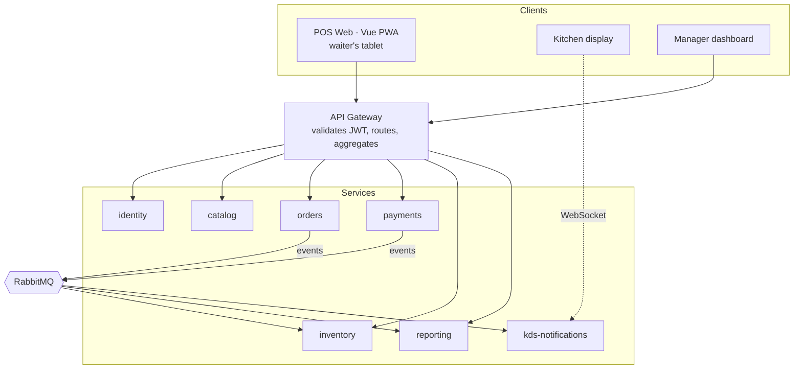

# AntojoPOS

A point-of-sale SaaS for independent restaurants and cafés, built on a microservices architecture with Laravel, Go, Node.js, RabbitMQ, and Kubernetes.

> **Honest engineering note.** For a product run by a single person, a modular monolith would be the right call, and this repo says so in [ADR-0001](docs/adr/0001-microservices-as-a-learning-decision.md). The distributed architecture here is a deliberate learning and portfolio choice, not a general recommendation. The service boundaries are still drawn the way they would be in production: separate databases, no cross-service joins, eventual consistency with compensation.

---

## What it does

| Role | What they can do |
|---|---|
| Waiter | Open a check by table, add products with modifiers, split a check, send to the kitchen |
| Kitchen (KDS) | See orders in real time, mark dishes as ready |
| Cashier | Charge (cash, card, mixed), record tips, open and close a cash drawer with a count |
| Manager | Menu and pricing per branch, inventory with recipes, sales and waste reports |
| Owner / multi-branch | Compare branches, manage users and permissions, tenant configuration |

Multi-tenant by design: one deployment serves many restaurants, each with its own branches.

---

## Architecture at a glance



Each service owns its own database, and nobody else touches it. See the [technical design](docs/technical-design.md).

---

## Stack

| Layer | Technology | Why |
|---|---|---|
| `identity`, `catalog`, `reporting` | Laravel 12 (PHP 8.3) | CRUD and auth: speed where the problem is well understood |
| `orders`, `payments`, `inventory` | **Go 1.23** | Strict typing over money and state; millisecond startup for autoscaling |
| `gateway` (BFF), `kds-notifications` | **TypeScript / NestJS** | Long-lived WebSocket connections and types shared with the frontend |
| Edge routing | Traefik | Declarative label-based routing, nothing to maintain |
| Messaging | RabbitMQ 4 | Topic routing is enough; running it costs far less than Kafka |
| Data | PostgreSQL 17 (one database per service) | A single engine, isolation by credential |
| Cache | Redis 7 | Catalog cache, rate limiting, distributed locks |
| Frontend | Vue 3 + Vite (PWA) | Has to run on an old tablet and survive network drops |
| Orchestration | Docker Compose → kind → AWS | Moves up a rung only when the previous one starts hurting |
| IaC | Terraform | Reproducible, versioned infrastructure |
| Observability | OpenTelemetry + Jaeger + Prometheus + Grafana | Without distributed tracing, debugging a saga is guesswork |
| CI/CD | GitHub Actions | Build, test, and push per service with a matrix |

The choice of three languages is argued in [ADR-0004](docs/adr/0004-language-selection.md), including the cost it carries.

---

## Documentation

| Document | Contents |
|---|---|
| [Technical design](docs/technical-design.md) | Boundaries, contracts, event catalog, multi-tenancy, security, data model |
| [Roadmap by session](docs/roadmap.md) | 84 work sessions with a deliverable and a done criterion each |
| [Path to a sellable product](docs/product-readiness.md) | What separates this repo from something you'd charge a client for |
| [ADRs](docs/adr/) | Architecture decisions with their cost and reversal criteria |
| [CLAUDE.md](CLAUDE.md) | Project context and invariants for working with Claude Code |
| [Brand brief](docs/brand-brief.md) | Brand brief and design prompts |

---

## Project status

| Phase | Description | Status |
|---|---|---|
| 0 | Design and contracts | ⬜ |
| 1 | identity, catalog, orders, gateway (synchronous) | ⬜ |
| 2 | Events, outbox, payments, closing saga | ⬜ |
| 3 | inventory, KDS, reporting (CQRS) | ⬜ |
| 4 | Observability and resilience | ⬜ |
| 5 | Local Kubernetes | ⬜ |
| 6 | AWS with Terraform and CI/CD | ⬜ |
| 7 | Hardening for real customers | ⬜ |

---

## Running it locally

```bash
git clone https://github.com/<user>/antojopos.git
cd antojopos
cp .env.example .env
make up          # brings up every service with Docker Compose
make seed        # demo tenant with menu and test users
```

| Service | Local URL |
|---|---|
| POS Web | http://localhost:5173 |
| API Gateway | http://localhost:8080 |
| RabbitMQ Management | http://localhost:15672 |
| Jaeger | http://localhost:16686 |
| Grafana | http://localhost:3000 |

Demo tenant credentials in `docs/demo-credentials.md`.

---

## License

Source-available under the [PolyForm Noncommercial License 1.0.0](LICENSE.md). Reading, studying, and running it for personal or evaluation purposes is free. Commercial use, including running it for a restaurant or any business, requires a separate commercial license: contact the author. The reasoning is in [ADR-0007](docs/adr/0007-repository-license.md).

This is not open source by the OSI definition, and outside contributions can't be merged until a contributor license agreement exists.
