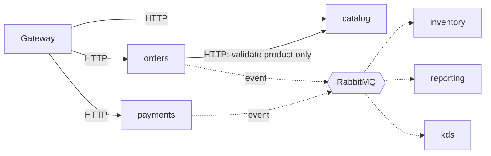
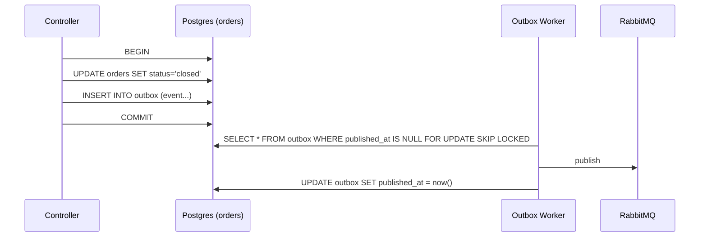
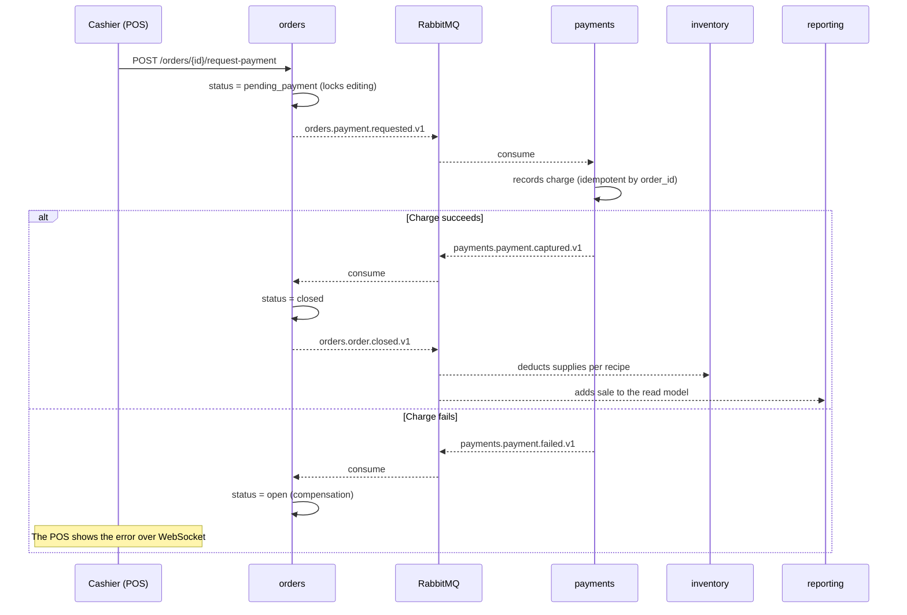
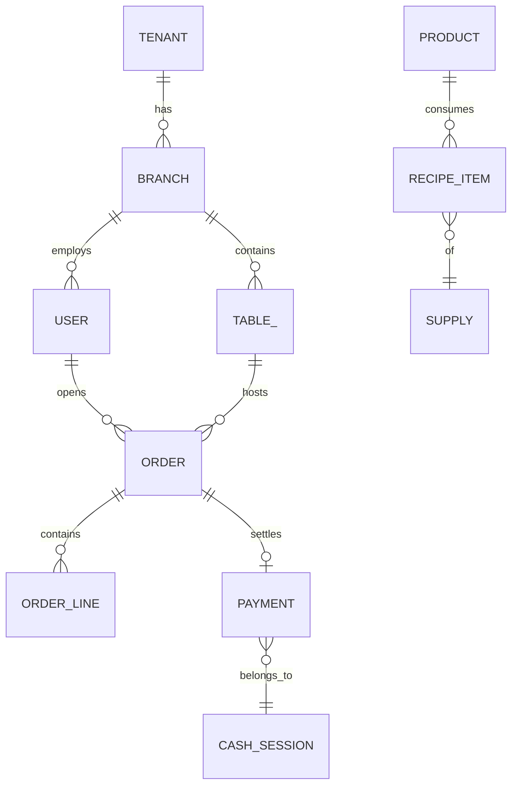

# Technical Design — AntojoPOS

- **Version:** 1.0
- **Date:** 2026-09-11
- **Status:** Current

This document describes the target architecture. When the code and this document disagree, the code wins and this document gets corrected.

---

## 1. Context and constraints

**What it is.** A multi-tenant POS SaaS for independent restaurants and cafés with 1 to 5 branches. One deployment serves every tenant.

**Real constraints that shape the design:**

| Constraint | Consequence in the design |
|---|---|
| A single developer | At most 7 services; nothing that needs a platform team to run |
| The restaurant loses internet and still has to sell | The POS is a PWA with a local queue; see §8 |
| The waiter's tablet is cheap and old | Small client bundle, no heavy frameworks on the client |
| A wrongly charged order is lost money | Idempotency and auditing in `payments` are not optional |
| Low infra budget until there are customers | A single Postgres instance with multiple databases through phase 6 |

**What v1 does NOT solve:** delivery and aggregator integrations, reservations, payroll, loyalty, CFDI e-invoicing (phase 7), franchises with legacy catalogs.

---

## 2. Service boundaries

Boundaries were cut by **business process that changes together**, not by entity or table.

| Service | Source of truth for | Expected scale | Language |
|---|---|---|---|
| `identity` | tenants, branches, users, roles, sessions | Low, read-heavy | Laravel |
| `catalog` | products, categories, modifiers, menus, price lists | Low writes, high cacheable reads | Laravel |
| `orders` | orders, tables, order lines, states | **High** — the operational peak | Go |
| `payments` | payments, tips, cash sessions, till counts | Medium, consistency-critical | Go |
| `inventory` | supplies, recipes, stock movements | Low, event-reactive | Go |
| `reporting` | denormalized sales read model | Read-only, tolerates lag | Laravel |
| `kds-notifications` | nothing persistent | Long-lived concurrent connections | TypeScript / NestJS |
| `gateway` | nothing | All traffic | Traefik + BFF in NestJS |

### The rule that makes this real microservices

**`orders` never joins against `catalog`.** When a product is added to an order, `orders` copies a snapshot inside its own line:

```json
{
  "line_id": "uuid",
  "product_ref": "uuid-in-catalog",
  "name_snapshot": "Cappuccino 12oz",
  "unit_price_snapshot": 6500,
  "modifiers_snapshot": [{ "name": "Oat milk", "price": 1500 }],
  "quantity": 2
}
```

If the price goes up tomorrow, yesterday's order doesn't change — which also happens to be the correct business behavior, not just a concession to the architecture. Every boundary drawn well justifies itself twice: technically and in the domain.

The same rule applies to `payments` (it stores the total, doesn't recompute it from `orders`) and to `reporting` (it stores names, not references).

### What is deliberately NOT split out

- **Authentication** doesn't get spread around: a single JWT issuer in `identity`, everyone else only validates the signature.
- **Tables** live inside `orders`, not in a service of their own. A table with no order has no behavior.
- **Tips** live in `payments`, not separately. They're calculated and split in the same ticket as the charge.

---

## 3. Communication

**Synchronous (HTTP/JSON) only when the user is waiting for the response.** Everything else goes over events.



The only synchronous call between business services is `orders → catalog`, to confirm a product exists and fetch its current price. It's cached in Redis with a 60-second TTL, invalidated by the `catalog.product.updated.v1` event. If `catalog` is down, `orders` serves from cache and logs the degradation — it doesn't reject the order. A POS that can't take orders because the catalog isn't responding is a useless POS.

### Event envelope

Every message shares this shape. It's a contract and doesn't change without versioning:

```json
{
  "event_id": "01J8Z...",
  "event_type": "orders.order.closed.v1",
  "occurred_at": "2026-09-11T18:42:07.311Z",
  "tenant_id": "uuid",
  "branch_id": "uuid",
  "correlation_id": "uuid",
  "causation_id": "event_id that caused this one",
  "producer": "orders",
  "schema_version": 1,
  "payload": { }
}
```

- `event_id` is the consumer's idempotency key.
- `correlation_id` travels from the first HTTP request and threads through the whole saga. It's what makes a trace in Jaeger legible.
- `causation_id` lets you reconstruct the causal tree when something went wrong.

### Event catalog

| Event | Producer | Consumers | Essential payload |
|---|---|---|---|
| `identity.tenant.created.v1` | identity | everyone | tenant_id, plan, timezone |
| `identity.branch.created.v1` | identity | catalog, orders, reporting | branch_id, name |
| `catalog.product.updated.v1` | catalog | orders (invalidates cache) | product_id, price, active |
| `orders.order.opened.v1` | orders | reporting, kds | order_id, table, waiter |
| `orders.item.sent_to_kitchen.v1` | orders | kds, inventory | lines with snapshot |
| `orders.payment.requested.v1` | orders | payments | order_id, total, breakdown |
| `orders.order.closed.v1` | orders | inventory, reporting | final lines, totals |
| `orders.order.cancelled.v1` | orders | inventory, reporting | reason, who authorized it |
| `orders.availability.marked_unavailable.v1` | orders | kds, reporting | product_ref, reason, who |
| `orders.availability.restored.v1` | orders | kds, reporting | product_ref |
| `inventory.stock.depleted.v1` | inventory | orders | supply, affected products |
| `orders.item.rejected.v1` | orders | kds | line_id, reason (unavailable after reconnect) |
| `payments.payment.captured.v1` | payments | orders, reporting | order_id, method, amount, tip |
| `payments.payment.failed.v1` | payments | orders | order_id, reason |
| `payments.cash_session.closed.v1` | payments | reporting | count, discrepancy |
| `inventory.stock.low.v1` | inventory | notifications, reporting | supply, remaining stock |

Naming convention: `<service>.<aggregate>.<fact in past tense>.v<n>`. An event describes something that **already happened**; if the name sounds like a command (`deduct_stock`), the boundary is wrong.

**Product availability** (see [ADR-0009](adr/0009-product-availability.md)): `orders` owns the shift's availability state — per branch and operating day, not per tenant — because it's the only service with no acceptable degradation (§8), and because the dominant cause ("we ran out of fish," "the fryer broke") doesn't always route through inventory. `catalog` remains the owner of what exists and which menu it's on. `inventory` only notifies when a supply hits zero; it doesn't decide. A manual mark from the kitchen always overrides an automatic one from inventory, and availability resets at the start of each shift.

### Exchanges and queues

One `topic exchange` called `antojopos.events`. Each consumer declares its own queue with its own binding:

```
inventory.orders-closed   ← binding: orders.order.closed.*
reporting.all             ← binding: #
kds.kitchen               ← binding: orders.item.sent_to_kitchen.*
```

Every queue has its own DLQ (`<queue>.dlq`) with a 3-retry policy and exponential backoff. A message in the DLQ is an alert, not a log line.

---

## 4. The Outbox pattern

Publishing to RabbitMQ inside a `DB::transaction` is a lie: if the commit fails after the publish, you emitted an event for something that never happened. The fix is not to publish directly.



`outbox` table in each producing service:

```sql
CREATE TABLE outbox (
    id              BIGSERIAL PRIMARY KEY,
    event_id        UUID NOT NULL UNIQUE,
    event_type      TEXT NOT NULL,
    tenant_id       UUID NOT NULL,
    correlation_id  UUID NOT NULL,
    payload         JSONB NOT NULL,
    created_at      TIMESTAMPTZ NOT NULL DEFAULT now(),
    published_at    TIMESTAMPTZ,
    attempts        SMALLINT NOT NULL DEFAULT 0
);
CREATE INDEX outbox_pending_idx ON outbox (created_at) WHERE published_at IS NULL;
```

The worker runs in its own container, separate from its service (`outbox-worker` in Go, `php artisan outbox:publish --daemon` in Laravel), with `SKIP LOCKED` so several replicas can run without duplicating work. The implementation lives in `services/_shared/<language>/outbox`, never inside a service itself.

This guarantees **at-least-once** delivery, not exactly-once. That's why the consumer has to be idempotent:

```sql
CREATE TABLE processed_events (
    event_id     UUID PRIMARY KEY,
    processed_at TIMESTAMPTZ NOT NULL DEFAULT now()
);
```

The consumer opens a transaction, inserts into `processed_events` (if it violates the PK, it already processed this and ACKs with no further work), applies the effect, and commits. Rows are purged after 30 days.

---

## 5. The checkout saga

This is the flow that justifies the whole architecture. It's worth implementing well before anything else asynchronous.



**Decisions that aren't obvious and need to be written down:**

- `pending_payment` is a real state, not a boolean. While it holds, the order accepts no edits. Without that lock, a waiter could add a dish between `requested` and `captured` and the customer would be undercharged.
- The saga timeout is 90 seconds. A scheduled job looks for orders in `pending_payment` older than that, returns them to `open`, and emits `orders.payment.timed_out.v1`. A saga with no timeout hangs forever.
- Inventory deduction happens on `order.closed`, not on `item.sent_to_kitchen`. Business reason: dishes cancelled in the kitchen shouldn't deduct stock. Waste is recorded separately.
- `payments` is idempotent by `order_id`, not only by `event_id`. If the same charge arrives twice through two different paths, it's still charged once.

---

## 6. Multi-tenancy

**Chosen model: tenant column.** See [ADR-0002](adr/0002-tenant-column-multi-tenancy.md).

Every table in every service carries `tenant_id UUID NOT NULL` and, where it applies, `branch_id UUID NOT NULL`.

Isolation lives in **one single place** per service: a trait on the base model with a global scope.

```php
trait BelongsToTenant
{
    protected static function bootBelongsToTenant(): void
    {
        static::addGlobalScope('tenant', fn (Builder $q) =>
            $q->where($q->getModel()->getTable().'.tenant_id', TenantContext::id())
        );

        static::creating(fn ($model) => $model->tenant_id ??= TenantContext::id());
    }
}
```

`TenantContext` is populated in a middleware from the `tid` JWT claim, and in event consumers from the envelope's `tenant_id` field. Never from a request parameter.

**Defense in depth.** The global scope is discipline; it can be bypassed with `withoutGlobalScopes()` or raw SQL. Hence:

1. An architecture test that walks every model and fails if any of them isn't using the trait.
2. A functional test that creates two tenants, authenticates as one, and tries to read from the other on every public endpoint, expecting a 404 or zero rows.
3. PostgreSQL Row Level Security as a final backstop, turned on in phase 7 for customers with sensitive data:

```sql
ALTER TABLE orders ENABLE ROW LEVEL SECURITY;
CREATE POLICY tenant_isolation ON orders
  USING (tenant_id = current_setting('app.tenant_id')::uuid);
```

---

## 7. Security and authentication

**Token flow.** `identity` issues an RS256-signed JWT. The private key exists only in `identity`; every other service validates against the public key, distributed through a JWKS endpoint (`GET /identity/.well-known/jwks.json`) and cached for 1 hour. This keeps a shared secret from circulating across seven repositories.

Claims:

```json
{
  "sub": "user_uuid",
  "tid": "tenant_uuid",
  "bid": "branch_uuid",
  "roles": ["waiter"],
  "exp": 1757620000,
  "jti": "uuid"
}
```

Access token lives 15 minutes, refresh token 30 days, stored in `identity` with rotation and reuse detection. A refresh token used twice invalidates its whole family — a signal of theft.

**Authorization.** The gateway only validates signature and expiration. Permission decisions live in each service, with a policy per resource. The gateway never decides whether a waiter can cancel an order — it doesn't know the domain.

**What gets audited without exception** (an `audit_log` table in `payments` and `orders`): cancelling an order, applying a discount, opening the till, closing the cash drawer with a discrepancy, changing a price. Each row with user, IP, terminal, and the previous value. This is not optional: theft in restaurants happens through exactly these five operations.

**Rate limiting** at the gateway by `tenant_id`, not by IP — every tablet in the restaurant shares the same outbound IP.

**Secrets.** Nothing in the repo. Local development uses an un-versioned `.env`; on AWS, Secrets Manager with variables injected at container startup.

---

## 8. Degraded and offline mode

A packed restaurant with the internet down still has to keep selling. If the POS doesn't allow that, it isn't sellable.

| Failure | Expected behavior |
|---|---|
| `catalog` goes down | `orders` serves the menu from Redis cache; alerts the manager |
| RabbitMQ goes down | Events pile up in `outbox`; the worker drains them once it's back. Nothing is lost |
| `reporting` goes down | Nobody notices until they open a report. Once it's back, it catches up on the backlog |
| `inventory` goes down | Sales continue; stock reconciles from the event backlog |
| **The restaurant's network goes down** | The PWA stores orders in IndexedDB and queues mutations; it syncs on reconnect |
| `orders` goes down | This is where operations actually stop. It's the only point with no possible degradation |

Offline sync is the hardest technical problem in the project: two waiters on the same table, both disconnected, each adding dishes. The strategy is **append-only lines with a client-generated ULID**, not state editing. Two waiters add different lines and both survive the merge. Only closing and charging require being online, and that's acceptable: the client is already standing at the register at that point. See [ADR-0003](adr/0003-offline-append-only-strategy.md).

---

## 9. Data model (per service)



The diagram is conceptual: **those relationships are not foreign keys across services.** `ORDER.user_id` is a UUID with no FK, because `users` lives in a different database. Cross-service referential integrity is traded for snapshots and edge validation. That's the explicit price of this architecture.

Schema conventions across all services:

- Money in **cents, as an integer** (`BIGINT`). Never `FLOAT`, never `DECIMAL` in application code.
- Timestamps as `TIMESTAMPTZ`, in UTC. The tenant's timezone is applied only at display time.
- Public identifiers: ULID (sortable, and generable on an offline client). Internal PK is `BIGSERIAL`.
- Nothing gets hard-deleted: `deleted_at` on anything the user can "delete."

---

## 10. Observability

Installed in phase 1, not at the end. Debugging a saga with no traces is guessing with technical vocabulary.

**Traces.** OpenTelemetry in every service, exporting to Jaeger (local) / Grafana Tempo (AWS). `correlation_id` propagates via the `traceparent` HTTP header and via the message envelope. Concrete target: seeing a single trace that runs from the cashier's tap all the way to the inventory deduction.

**Logs.** Structured JSON to stdout, with `tenant_id`, `correlation_id`, `service`, and `user_id` on every line. Never personal data or amounts in the free-text message.

**Metrics** (Prometheus, the four golden signals plus business ones):

| Metric | Why it matters |
|---|---|
| `http_request_duration_seconds` per route | Latency as the waiter experiences it |
| `outbox_pending_total` | If it rises and doesn't fall, the worker died |
| `saga_duration_seconds` | How long a full checkout takes end to end |
| `saga_timed_out_total` | Stuck sagas — alert immediately |
| `dlq_messages_total` | Any value above zero is an alert |
| `orders_open_total` per branch | A business metric that also catches bugs |

**Alerts worth waking someone up for:** messages in the DLQ, `outbox_pending` climbing for 5 minutes straight, `orders` down, `payments` error rate above 1%.

---

## 11. Repository structure

Monorepo. With a single developer, seven repos means seven PRs for a single contract change.

```
antojopos/
├── services/
│   ├── identity/            # Laravel
│   ├── catalog/
│   ├── orders/
│   ├── payments/
│   ├── inventory/
│   ├── reporting/
│   ├── kds-notifications/   # Node
│   └── gateway/
├── apps/
│   ├── pos-web/             # Vue 3 PWA
│   └── kds-web/
├── contracts/
│   ├── openapi/             # one .yaml per service
│   ├── asyncapi/            # event catalog
│   └── events/              # versioned JSON Schema per event
├── infra/
│   ├── docker/
│   ├── k8s/
│   └── terraform/
├── docs/
│   ├── technical-design.md
│   ├── roadmap.md
│   ├── product-readiness.md
│   └── adr/
├── .github/workflows/
└── Makefile
```

Contracts live **outside** the services on purpose: they're the agreement between them, not any one service's property. CI fails if a service publishes an event that doesn't validate against its JSON Schema in `contracts/events/`.

---

## 12. Testing strategy

| Level | Covers | Tool | Where it runs |
|---|---|---|---|
| Unit | Domain rules: total calculation, check splitting, recipe deduction | Pest | Per service |
| Integration | Repositories against a real Postgres, outbox publishing | Pest + Testcontainers | Per service |
| **Contract** | That the producer emits what the consumer expects | JSON Schema + Pact | CI |
| Component | A full service with its dependencies mocked | Pest | Per service |
| E2E | The checkout saga end to end, with everything running | Playwright + Compose | CI, `main` only |

Contract tests are the ones that actually matter in this architecture. A unit test won't catch that you renamed `total` to `total_cents` in an event and broke `reporting`.

**Minimum coverage to merge:** 70% in `orders` and `payments`, 50% elsewhere. The low numbers are honest; a mandatory 90% everywhere produces filler tests.

---

## 13. Known risks

| Risk | Likelihood | Mitigation |
|---|---|---|
| Boundaries are drawn wrong and `orders`/`catalog` end up calling each other constantly | Medium | If, at the end of phase 2, there are more than 2 cross-service synchronous calls, reconsider the split |
| Offline sync eats more time than the rest of the project combined | **High** | Scope it to append-only; no CRDTs |
| The project gets abandoned in phase 4 | High | Every phase leaves something demonstrable and deployed, not half-finished code |
| AWS costs spiral | Medium | Phase 6 with a budget cap and a billing alarm; ECS Fargate before EKS if cost gets tight |
| Over-engineering that gets in the way of selling | Medium | Phase 7 exists exactly for this; see `product-readiness.md` |

---

## 14. Architecture reversal criteria

This architecture has failed if, by the end of phase 3, any of these hold:

- A typical feature change requires touching four or more services.
- Local startup time exceeds 3 minutes and people stop using it for development.
- There are more than two synchronous HTTP calls between business services outside of `orders → catalog`.

In that case, the fallback plan is to collapse `catalog`, `inventory`, and `reporting` into `orders` as modules, keeping the split only for `identity`, `payments`, and `kds`. That's still a defensible distributed system, at half the operational cost.
